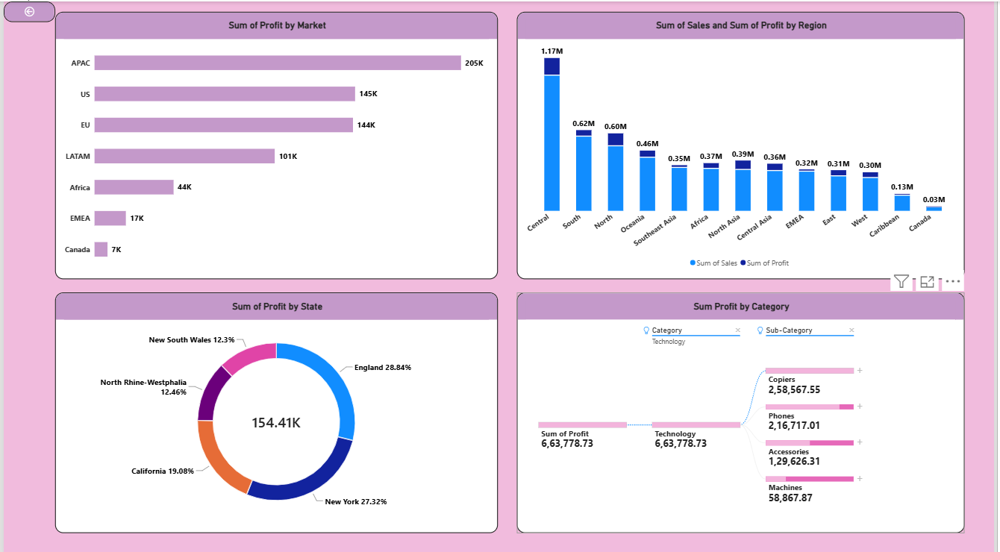
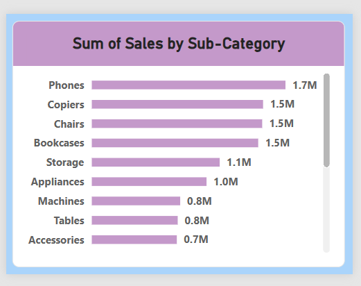

# Executive Sales Dashboard | Power BI

## Project Overview

The Executive Sales Dashboard is an interactive business intelligence project developed using Microsoft Power BI. It provides a comprehensive overview of sales performance, profitability, product categories, customer segments, and regional trends.

The dashboard helps users analyze business performance, identify sales patterns, and make data-driven decisions through interactive visualizations.

## Tools & Technologies

- Microsoft Power BI Desktop
- Power Query
- DAX (Data Analysis Expressions)
- Data Modeling
- Data Visualization

## Dashboard Features

### 1. Executive Sales Overview
- Total Sales, Total Profit, and Total Quantity KPI cards
- Monthly Sales Trend Analysis
- Profit Analysis by Product Category
- Profit Analysis by Customer Segment
- Geographical Sales Distribution
- Interactive Date and Segment Filters

### 2. Drillthrough Analysis
- Profit Analysis by Market
- Sales and Profit Analysis by Region
- Profit Analysis by State
- Decomposition Tree for detailed exploration

### 3. Advanced Tooltips
- Interactive report page tooltips
- Sub-category sales breakdown
- Additional insights without switching dashboard pages

## Key Power BI Concepts

- Data Cleaning and Transformation
- Data Modeling and Relationships
- DAX Measures and KPI Calculations
- Interactive Charts and Slicers
- Drillthrough Functionality
- Advanced Report Tooltips
- Bookmarks and Hierarchies

## Business Objectives

- Monitor overall sales and profitability.
- Compare business performance across product categories.
- Identify regional and market-level trends.
- Analyze customer segments.
- Support data-driven business decisions.

## Dashboard Screenshots

### 1. Executive Sales Dashboard - Product View

### 2. Executive Sales Dashboard - Location View

### 3. Drillthrough Analysis

### 4. Advanced Tooltip

## How to Use

1. Download the `Executive_Sale_Dashboard.pbix` file.
2. Open it using Microsoft Power BI Desktop.
3. Explore the dashboard pages.
4. Use the interactive slicers and drillthrough features to analyze sales performance.

## Author

**Idrisi Mohd Salman**

B.Tech in Computer Science and Engineering

Interested in Data Analytics, Business Intelligence, SQL, Excel, Python, and Power BI.

## Project File

`Executive_Sale_Dashboard.pbix`

---

*Created as part of my Data Analytics portfolio to demonstrate interactive dashboard development and business intelligence skills.*
